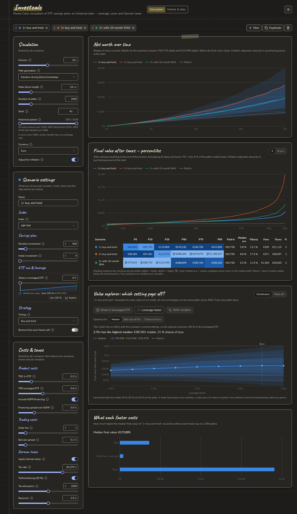

# Investcalc

A browser-based website that runs Monte Carlo simulations of ETF portfolios under different investment strategies (e.g. lump sum vs. DCA) and visualizes the distribution of outcomes.

**Live:** https://flayms.github.io/Investcalc/

- **Historical data:** S&P 500 (since 1871), MSCI World and MSCI ACWI / All World (since 2001), monthly total returns, plus the short rate as SOFR proxy.
- **Path generation:** every real historical window, or thousands of paths from _random slicing_ (stationary block bootstrap: random contiguous blocks of history, so crashes and volatility regimes stay intact).
- **Products:** 1× ETF, leveraged ETF (1×–3×, daily reset with volatility drag, SOFR + spread financing) or any mix of both.
- **Costs and German taxes:** TER, order fees, bid-ask spread; Abgeltungsteuer + Soli, Teilfreistellung, Sparerpauschbetrag, Vorabpauschale, loss carry-forward.
- **Strategies:** savings plan (buy and hold), SMA trend filter, "borrow from your future self" (invest a loan worth future contributions now).
- **Scenarios:** compare up to 8 scenarios of your own choices (index, amounts, mix, leverage, strategy); costs, taxes and the data period are shared by all of them. Hide scenarios you don't want to compare right now with the eye toggle, and reorder them by dragging their tabs (or with the arrow buttons). Everything is saved in your browser and restored after a reload.
- **Results:** fan chart and a percentile table color-coded per column so the winner stands out; leverage explorer (which factor pays off, and at what downside); how much each cost factor costs.
- **Market & data:** current market phase (bull/bear, SMA position), key indicators (trailing returns, recent volatility, short rate), a chart with a selectable time frame (1 year to the whole history, log scale for long ones), historic bear and bull markets, and the data basis on their own view.
- **Exact input:** every slider has a box next to it to type the exact value (e.g. €437 per month or a 0.07 % TER).
- **Notebook look, light and dark:** styled like a scribbled notebook page; switch between light and dark in the header (defaults to your system setting).

Specialised on German investors and German tax law. Not investment advice.





On phones, results and settings are two views (switch at the top):


## Development

Requires [mise](https://mise.jdx.dev) (installs Bun and Node from `mise.toml`).

```sh
mise install
bun install
bunx playwright install chromium   # once, for e2e tests
bun run dev
```

| Command               | What it does                            |
| --------------------- | --------------------------------------- |
| `bun run dev`         | Dev server                              |
| `bun run build`       | Typecheck + production build to `dist/` |
| `bun run test`        | Unit tests (Vitest)                     |
| `bun run test:e2e`    | Browser tests (Playwright)              |
| `bun run lint`        | Lint + format check (Biome)             |
| `bun run format`      | Apply Biome fixes                       |
| `bun run screenshots` | Regenerate `docs/screenshots/`          |
| `bun run data:fetch`  | Re-download the historical data         |

## Deployment

Every push to `main` is built and published to GitHub Pages by `.github/workflows/deploy.yml`
(one-time setup: _Settings → Pages → Source: GitHub Actions_).
