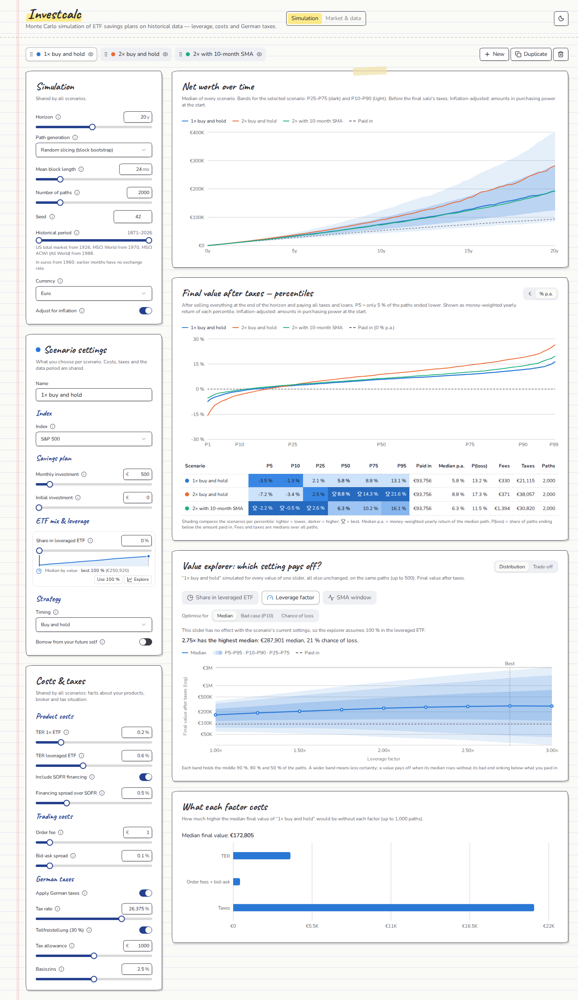
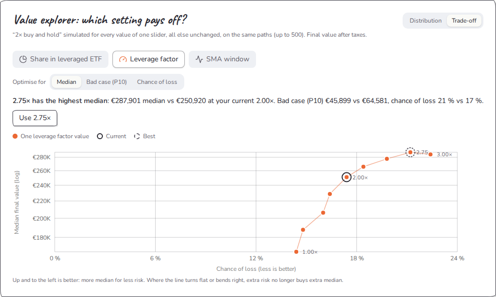
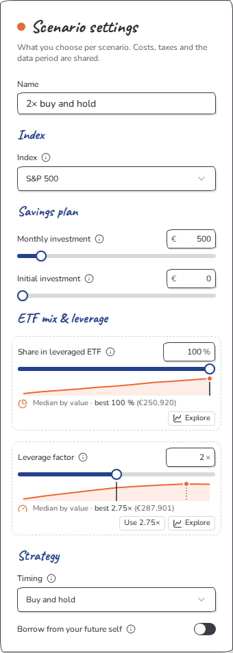
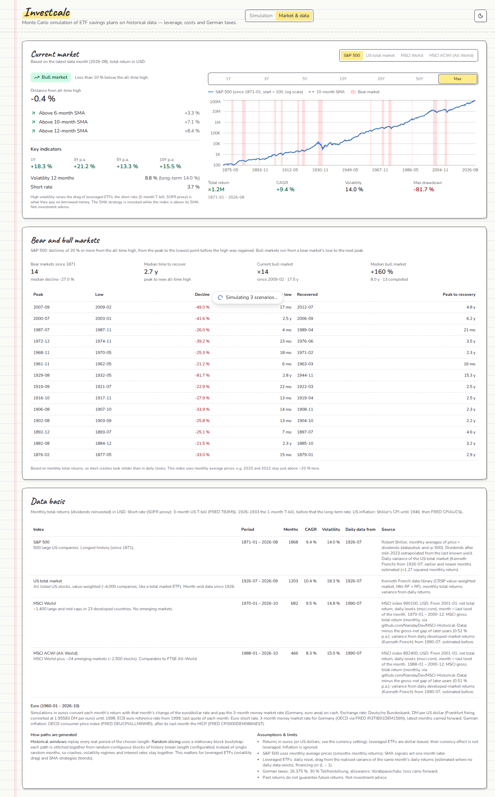
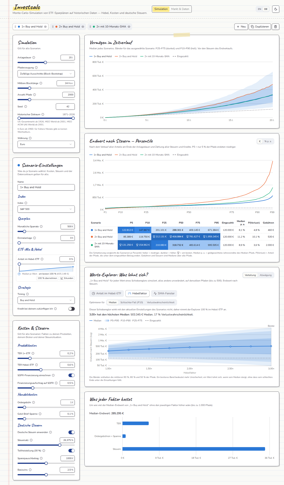

# Investcalc

A browser-based website that runs Monte Carlo simulations of ETF portfolios under different investment strategies (e.g. lump sum vs. DCA) and visualizes the distribution of outcomes.

**Live:** https://flayms.github.io/Investcalc/

- **Historical data:** S&P 500 (since 1871), US total market (since 1926), MSCI World (since 1970) and MSCI ACWI / All World (since 1988), monthly total returns, plus the short rate as SOFR proxy. The volatility drag of leveraged ETFs uses the realised variance of each month's daily returns (estimated for the S&P 500 before 1926).
- **Inflation:** results in purchasing power at the start (default) or nominal; German inflation for euros, US inflation for dollars, taxes always on nominal gains.
- **Currency:** simulate in euros (default; from 1960, exchange rates from the Bundesbank and ECB, cash earns the German / euro money market rate) or in US dollars (full history).
- **Path generation:** every real historical window, or thousands of paths from _random slicing_ (stationary block bootstrap: random contiguous blocks of history, so crashes and volatility regimes stay intact).
- **Products:** 1× ETF, leveraged ETF (1×–3×, daily reset with volatility drag, SOFR + spread financing) or any mix of both.
- **Costs and German taxes:** TER, order fees, bid-ask spread; Abgeltungsteuer + Soli, Teilfreistellung, Sparerpauschbetrag, Vorabpauschale, loss carry-forward.
- **Strategies:** savings plan (buy and hold), SMA trend filter, "borrow from your future self" (invest a loan worth future contributions now).
- **Scenarios:** compare up to 8 scenarios of your own choices (index, amounts, mix, leverage, strategy); costs, taxes and the data period are shared by all of them. Hide scenarios you don't want to compare right now with the eye toggle, and reorder them by dragging their tabs (mouse, press-and-hold on touch, or the grip handle with Space and the arrow keys). Everything is saved in your browser and restored after a reload.
- **Results:** fan chart; a chart of the final value against the percentile (P1–P99) and a percentile table color-coded per column so the winner stands out, both switchable between € and yearly return (% p.a.); value explorer for the share in the leveraged ETF, the leverage factor and the SMA window (which value pays off for the selected scenario, optimised for the median, the bad case or the chance of loss, shown as a distribution or a risk/return trade-off); how much each cost factor costs.
- **Find good values right at the slider:** under those three sliders a small curve shows how the chosen goal changes over the slider's range, marks the best value and applies it with one click; _Explore_ opens the full diagram.
- **Always see what is running:** a floating status shows when scenarios are simulated or analysed, wherever you have scrolled to; outdated charts stay visible, dimmed and marked _Updating_.
- **Market & data:** current market phase (bull/bear, SMA position), key indicators (trailing returns, recent volatility, short rate), a chart with a selectable time frame (1 year to the whole history, log scale for long ones), historic bear and bull markets, and the data basis on their own view.
- **Exact input:** every slider has a box next to it to type the exact value (e.g. €437 per month or a 0.07 % TER).
- **Notebook look, light and dark:** styled like a scribbled notebook page; switch between light and dark in the header (defaults to your system setting).
- **English or German:** switch the language with _EN / DE_ in the header; text and number formats follow it (`1.234 €`, `12,3 %`). The first visit follows your browser language, your choice is remembered.

Specialised on German investors and German tax law. Not investment advice.












On phones, results and settings are two views (switch at the top):


Auf Deutsch:




## Development

Requires [mise](https://mise.jdx.dev) (installs Bun and Node from `mise.toml`).

```sh
mise install
bun install
bunx playwright install chromium   # once, for e2e tests
bun run dev
```

| Command               | What it does                            |
| --------------------- | --------------------------------------- |
| `bun run dev`         | Dev server                              |
| `bun run build`       | Typecheck + production build to `dist/` |
| `bun run test`        | Unit tests (Vitest)                     |
| `bun run test:e2e`    | Browser tests (Playwright)              |
| `bun run lint`        | Lint + format check (Biome)             |
| `bun run format`      | Apply Biome fixes                       |
| `bun run screenshots` | Regenerate `docs/screenshots/`          |
| `bun run data:fetch`  | Re-download the historical data         |

## Deployment

Every push to `main` is built and published to GitHub Pages by `.github/workflows/deploy.yml`
(one-time setup: _Settings → Pages → Source: GitHub Actions_).
