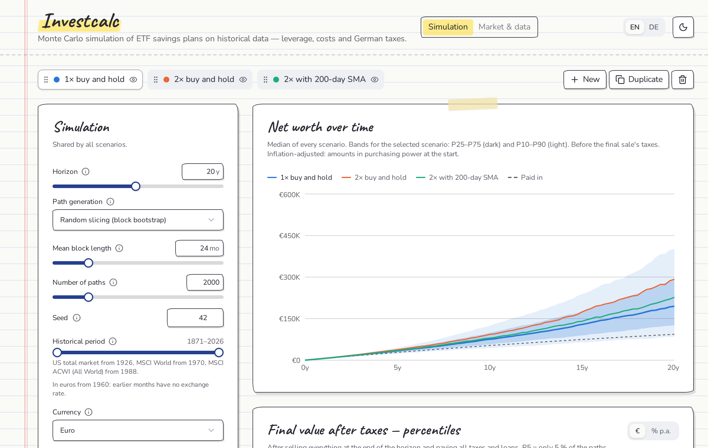
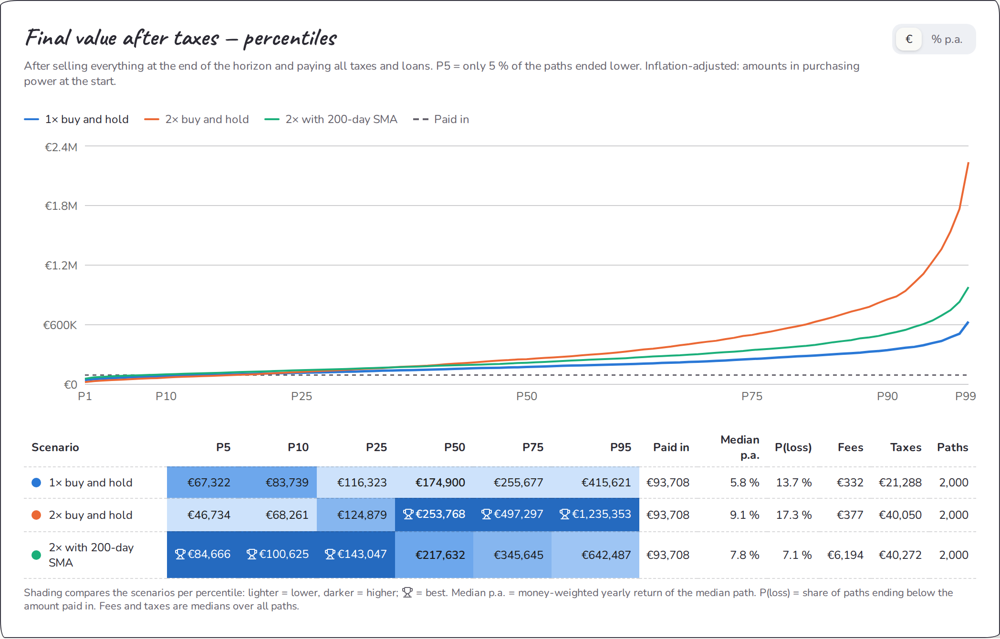
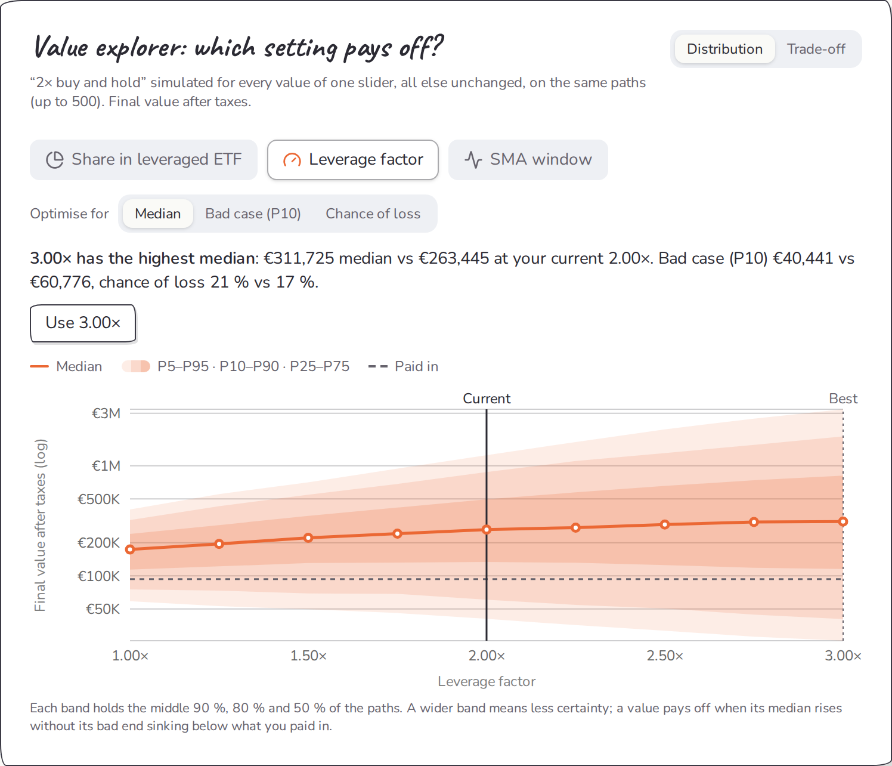
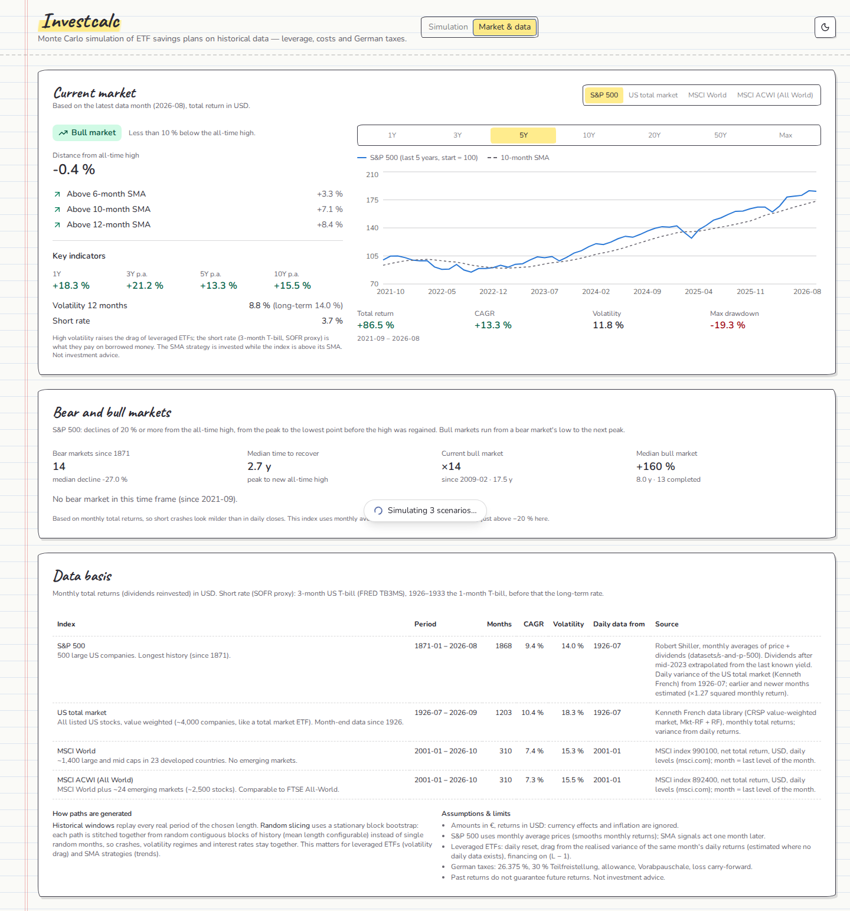

# Investcalc

Monte Carlo simulation of ETF savings plans on real market history: compare strategies, leverage, costs and German taxes, and see the whole range of outcomes, not just the average.

**Live:** https://flayms.github.io/Investcalc/ · Made for German investors and German tax law. Not investment advice.

<picture>
  <source media="(prefers-color-scheme: dark)" srcset="docs/screenshots/home-dark.png">
  
</picture>

## What it does

- **History, not guesses:** S&P 500 since 1871, US total market, MSCI World and ACWI, in euros or dollars, nominal or inflation-adjusted.
- **Products and strategies:** 1× and leveraged ETFs (with volatility drag), savings plan, SMA trend filter (the 200-day line, checked at every daily close), investing a loan up front.
- **Costs and German taxes:** TER, order fees, spread, Abgeltungsteuer, Teilfreistellung, Sparerpauschbetrag, Vorabpauschale.
- **Compare scenarios:** up to 8 side by side, hide or reorder them; everything is saved in your browser.
- **Results:** fan chart, percentiles in € or % p.a., the cost of each factor, and the best value of a slider.
- **Market view:** current bull or bear phase, key indicators, bear markets since 1871 and the data sources.
- **Light or dark, English or German**, on desktop and phone.

Terms like percentile, random slicing or volatility drag are explained in the [glossary](docs/glossary.md).

## Tour



Final value after taxes for every percentile, with a table that marks the best scenario per column.



The value explorer runs one slider over its whole range and shows which value pays off.

| Best value under the slider                                                                   | On a phone                                                                           |
| --------------------------------------------------------------------------------------------- | ------------------------------------------------------------------------------------ |
|  |  |
| A small curve under the slider marks the best value; _Explore_ opens the full diagram.        | Results and settings are two views on a phone.                                       |



The market view: phase, key indicators and the whole history on a log scale.

## Development

Requires [mise](https://mise.jdx.dev) (installs Bun and Node from `mise.toml`).

```sh
mise install
bun install
bunx playwright install chromium   # once, for e2e tests
bun run dev
```

| Command               | What it does                            |
| --------------------- | --------------------------------------- |
| `bun run dev`         | Dev server                              |
| `bun run build`       | Typecheck + production build to `dist/` |
| `bun run test`        | Unit tests (Vitest)                     |
| `bun run test:e2e`    | Browser tests (Playwright)              |
| `bun run lint`        | Lint + format check (Biome)             |
| `bun run format`      | Apply Biome fixes                       |
| `bun run screenshots` | Regenerate `docs/screenshots/`          |
| `bun run data:fetch`  | Re-download the historical data         |

## Deployment

Every push to `main` is built and published to GitHub Pages by `.github/workflows/deploy.yml`
(one-time setup: _Settings → Pages → Source: GitHub Actions_).
