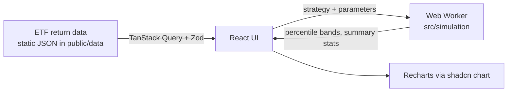

# Architecture

Static single-page app, no backend. Simulations run entirely in the browser, off the main thread.

- `src/main.tsx` — entry; mounts `App` inside the TanStack Query provider and the sonner `Toaster`, loads the handwriting fonts (`@fontsource/caveat`, `@fontsource/atkinson-hyperlegible`).
- `src/index.css` — theme: light and dark CSS variables (shadcn tokens, the categorical `--series-N` scenario colors and the `--heat-N` / `--heat-ink-N` table ramp, each stepped per theme) and the notebook look (ruled paper, hand-drawn outlines, tape, highlighter). The notebook rules are unlayered on purpose so they override the utility classes of the shadcn primitives without forking them. The dark theme is the `.dark` class on `<html>`, set before first paint by an inline script in `index.html` and toggled by `features/theme`.
- `src/components/ui/` — shadcn/ui components (generated with `bunx shadcn@latest add <name>`, excluded from Biome).
- `src/simulation/` — the simulation engine: pure, framework-free TypeScript so it can be unit-tested and run inside a Web Worker.
  - `sampling.ts` historical windows + stationary block bootstrap, `rng.ts` seeded PRNG
  - `leverage.ts` daily-reset leveraged return (volatility drag, financing), `tax.ts` German tax rules
  - `portfolio.ts` month-by-month simulation of one path (contributions, funds, cash, loan, taxes, strategy)
  - `simulate.ts` builds paths from a dataset and aggregates percentiles, leverage sweep, factor impact
  - `protocol.ts` / `worker.ts` messages between UI and Web Worker; `market.ts` current market phase
- `src/features/` — UI by feature: `data` (loading, data basis), `scenarios` (settings, field metadata with tooltips and recommendations), `simulation` (worker client, hook), `results` (charts, tables, heatmap shading), `market`, `persistence` (dashboard state in `localStorage`), `theme` (light/dark switch, stored in `localStorage`, defaulting to the system preference).
  - A scenario in the UI only holds the user's _choices_ (`ScenarioChoices`); _shared settings_ (data period, product and trading costs, taxes) are kept once and merged with `toParams` into the engine's `ScenarioParams` before simulating. The engine itself is unaware of the split.
  - The dashboard state (scenarios, selection, simulation and shared settings) is saved to `localStorage` on every change, versioned and validated with Zod on load; invalid state falls back to the defaults.
- `scripts/fetch-data.ts` — downloads the historical data into `public/data/*.json` (committed).
- `.github/workflows/deploy.yml` — builds and publishes to GitHub Pages (relative `base` in `vite.config.ts`).

## Tech Stack

| Concern | Technology              | Purpose                                                          |
| ------- | ----------------------- | ---------------------------------------------------------------- |
| UI      | React                   | Component framework                                              |
| UI      | Tailwind                | Styling                                                          |
| UI      | shadcn/ui               | Components with good styling defaults                            |
| UI      | Radix UI, sonner        | Primitives behind shadcn (menus, toasts)                         |
| UI      | Recharts (shadcn chart) | Fan charts / histograms of simulation outcomes                   |
| Tooling | Vite                    | Build tool, dev server, native Web Worker bundling               |
| Tooling | TypeScript              | Language                                                         |
| Tooling | mise                    | Tool version management (Bun, Node)                              |
| Tooling | Bun                     | Package manager and script runner                                |
| Tooling | Biome                   | Lint + format                                                    |
| Tooling | Vitest                  | Unit testing                                                     |
| Tooling | Playwright              | Browser testing and README/PR screenshots                        |
| Misc    | TanStack Query          | Loading and caching ETF return data                              |
| Misc    | Zod                     | Validating loaded data, strategy parameters and URL-shared state |

Deliberately not included (add when needed): TanStack Virtual (no large lists yet), cmdk (no command palette yet).

The simulation runs in a module Web Worker (`new Worker(new URL(...), { type: "module" })`); in environments without workers (unit tests) `SimulationClient` runs it on the main thread.
