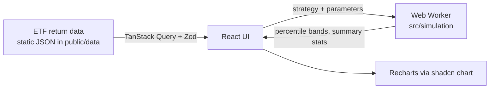

# Architecture

Static single-page app, no backend. Simulations run entirely in the browser, off the main thread.

- `src/main.tsx` — entry; mounts `App` inside the TanStack Query provider and the sonner `Toaster`.
- `src/components/ui/` — shadcn/ui components (generated with `bunx shadcn@latest add <name>`, excluded from Biome).
- `src/simulation/` — the simulation engine (planned): pure, framework-free TypeScript so it can be unit-tested and run inside a Web Worker.

## Tech Stack

| Concern | Technology              | Purpose                                                          |
| ------- | ----------------------- | ---------------------------------------------------------------- |
| UI      | React                   | Component framework                                              |
| UI      | Tailwind                | Styling                                                          |
| UI      | shadcn/ui               | Components with good styling defaults                            |
| UI      | Radix UI, sonner        | Primitives behind shadcn (menus, toasts)                         |
| UI      | Recharts (shadcn chart) | Fan charts / histograms of simulation outcomes                   |
| Tooling | Vite                    | Build tool, dev server, native Web Worker bundling               |
| Tooling | TypeScript              | Language                                                         |
| Tooling | mise                    | Tool version management (Bun, Node)                              |
| Tooling | Bun                     | Package manager and script runner                                |
| Tooling | Biome                   | Lint + format                                                    |
| Tooling | Vitest                  | Unit testing                                                     |
| Tooling | Playwright              | Browser testing and README/PR screenshots                        |
| Misc    | TanStack Query          | Loading and caching ETF return data                              |
| Misc    | Zod                     | Validating loaded data, strategy parameters and URL-shared state |

Deliberately not included (add when needed): TanStack Virtual (no large lists yet), cmdk (no command palette yet).

Planned: Web Worker for the simulation loop (Vite `?worker` import; add Comlink if the message passing gets clumsy), a seeded PRNG for reproducible runs.
