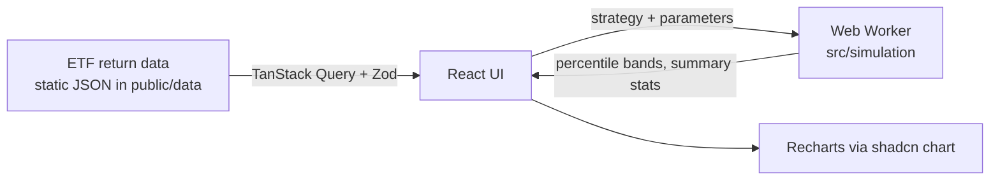

# Architecture

Static single-page app, no backend. Simulations run entirely in the browser, off the main thread.

- `src/main.tsx` — entry; mounts `App` inside the TanStack Query provider and the sonner `Toaster`, loads the fonts (`@fontsource/caveat` for handwritten headings, `@fontsource/nunito` for body text and numbers).
- `src/index.css` — theme: light and dark CSS variables (shadcn tokens, the categorical `--series-N` scenario colors and the `--heat-N` / `--heat-ink-N` table ramp, each stepped per theme) and the notebook look (ruled paper, hand-drawn outlines, tape, highlighter). The notebook rules are unlayered on purpose so they override the utility classes of the shadcn primitives without forking them. The dark theme is the `.dark` class on `<html>`, set before first paint by an inline script in `index.html` and toggled by `features/theme`; the same script sets `<html lang>`.
- `src/components/ui/` — shadcn/ui components (generated with `bunx shadcn@latest add <name>`, excluded from Biome).
- `src/components/ChartTooltipBox.tsx` — themed tooltip surface and series row shared by all Recharts tooltips (never use the default tooltip, it is white in the dark theme).
- `src/simulation/` — the simulation engine: pure, framework-free TypeScript so it can be unit-tested and run inside a Web Worker.
  - `sampling.ts` historical windows + stationary block bootstrap, `rng.ts` seeded PRNG
  - `leverage.ts` daily-reset leveraged return (volatility drag, financing), `tax.ts` German tax rules
  - `currency.ts` converts a USD dataset for euro investors (exchange rate change and euro short rate per month, `datasetFor` picks the scenario's dataset in its currency)
  - `history.ts` splices older gross return history onto net series (gross–net gap)
  - `daily.ts` daily returns → monthly return and realised variance, estimate for months without daily data (used by the download script)
  - `portfolio.ts` month-by-month simulation of one path (contributions, funds, cash, loan, taxes, strategy); nominal throughout, amounts deflated only when reported (inflation adjustment)
  - `simulate.ts` builds paths from a dataset and aggregates percentiles (bands over time, final value at P1–P99), factor impact
  - `sweep.ts` sweeps one slider (leveraged share, leverage factor, SMA window) over its range on the same paths and picks the best value for a goal
  - `protocol.ts` / `worker.ts` messages between UI and Web Worker (`run`, `sweep`, `factors`); `market.ts` market phase, chart series per time frame, period statistics, bear/bull markets and key indicators
- `src/features/` — UI by feature: `data` (loading, data basis), `scenarios` (settings, drag-and-drop scenario bar with @dnd-kit, field metadata with tooltips and recommendations), `simulation` (worker client with a queue that drops superseded requests and runs the scenario simulation before analyses; hook that keeps the latest result per scenario with the inputs it was computed from (settings without the name, global settings) and only re-simulates scenarios whose inputs changed, reruns the analyses only when the selected scenario's inputs change, and keeps previous results visible while recalculating; floating status), `explorer` (value explorer card and the small goal curve under each explored slider; both share the slider's label, icon and range from `fields.ts`), `results` (charts, tables, heatmap shading; the € / % p.a. unit of the percentiles is local UI state, the yearly return is derived in `annualReturn.ts`), `market` (`MarketView` holds the selected index and time frame shared by the status and the bear/bull market cards), `persistence` (dashboard state in `localStorage`), `theme` (light/dark switch, stored in `localStorage`, defaulting to the system preference), `i18n` (English / German, see below).
  - **UI language (`features/i18n`):** typed dictionaries, `messages/en.ts` is the source and `Messages = typeof en`, so `de.ts` must have every key (typecheck). `I18nProvider` in `App` holds the language (stored under its own `localStorage` key, defaulting to the browser language) and provides `t` and `format` (`createFormat(language)` in `src/lib/format.ts`) through `useI18n()`; without a provider it is English. Setting labels, help and option labels live in `t.fields[key]`, `fields.ts` only holds keys, ranges and checks. The engine returns IDs, never display text (factor IDs, time frame IDs, `SimulationError` objects), and the UI words them (`errors.ts`). Data files stay English; `t.datasets[id]` translates their names, descriptions and sources (`datasets.ts`).
  - A scenario in the UI only holds the user's _choices_ (`ScenarioChoices`); _shared settings_ (data period, product and trading costs, taxes) are kept once and merged with `toParams` into the engine's `ScenarioParams` before simulating. _Hidden_ scenarios (`hidden: true`) are filtered out before that, so they are neither simulated nor shown; their last result is kept, so showing them again needs no simulation if nothing changed. The engine itself is unaware of the split.
  - The dashboard state (scenarios, selection, simulation and shared settings) is saved to `localStorage` on every change, versioned and validated with Zod on load; invalid state falls back to the defaults.
- `scripts/fetch-data.ts` — downloads the historical data (Shiller, Kenneth French data library, MSCI daily levels, FRED, Bundesbank exchange rates) into `public/data/*.json` (committed). Each month holds its total return, short rate, inflation and realised variance of daily returns; `eur.json` holds the monthly euro/dollar change, the euro short rate and German inflation. MSCI history before 2001 comes from a pinned public GitHub export of MSCI's gross series.
- `.github/workflows/deploy.yml` — builds and publishes to GitHub Pages (relative `base` in `vite.config.ts`).

## Tech Stack

| Concern | Technology              | Purpose                                                          |
| ------- | ----------------------- | ---------------------------------------------------------------- |
| UI      | React                   | Component framework                                              |
| UI      | Tailwind                | Styling                                                          |
| UI      | shadcn/ui               | Components with good styling defaults                            |
| UI      | Radix UI, sonner        | Primitives behind shadcn (menus, toasts)                         |
| UI      | Recharts (shadcn chart) | Fan charts / histograms of simulation outcomes                   |
| Tooling | Vite                    | Build tool, dev server, native Web Worker bundling               |
| Tooling | TypeScript              | Language                                                         |
| Tooling | mise                    | Tool version management (Bun, Node)                              |
| Tooling | Bun                     | Package manager and script runner                                |
| Tooling | Biome                   | Lint + format                                                    |
| Tooling | Vitest                  | Unit testing                                                     |
| Tooling | Playwright              | Browser testing and README/PR screenshots                        |
| UI      | @dnd-kit                | Sortable scenario tabs (mouse, touch, keyboard)                  |
| Misc    | TanStack Query          | Loading and caching ETF return data                              |
| Misc    | Zod                     | Validating loaded data, strategy parameters and URL-shared state |

Deliberately not included (add when needed): TanStack Virtual (no large lists yet), cmdk (no command palette yet).

The simulation runs in a module Web Worker (`new Worker(new URL(...), { type: "module" })`); in environments without workers (unit tests) `SimulationClient` runs it on the main thread.
